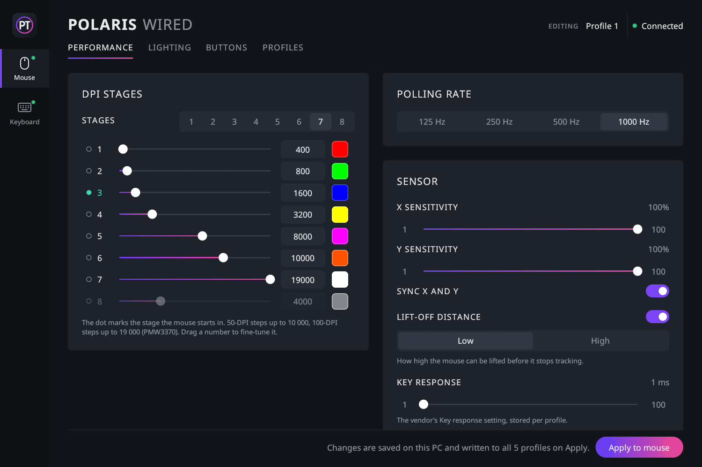
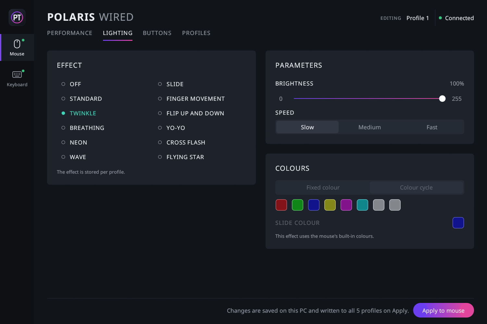
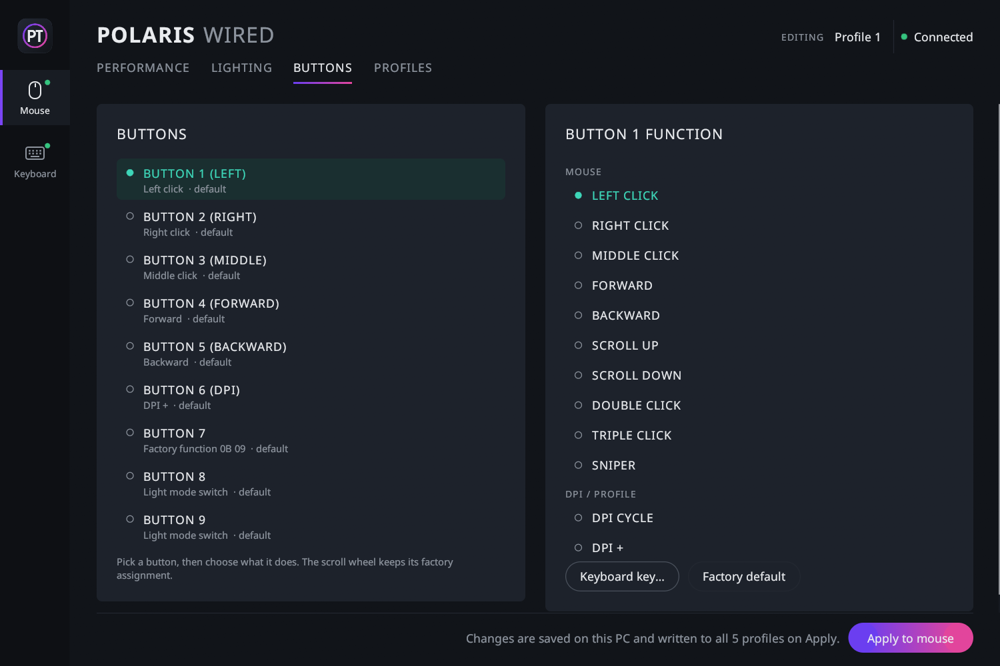
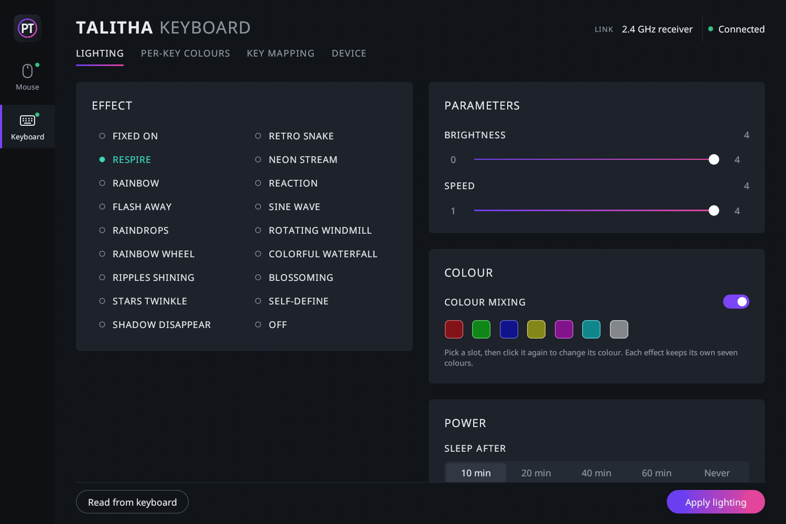
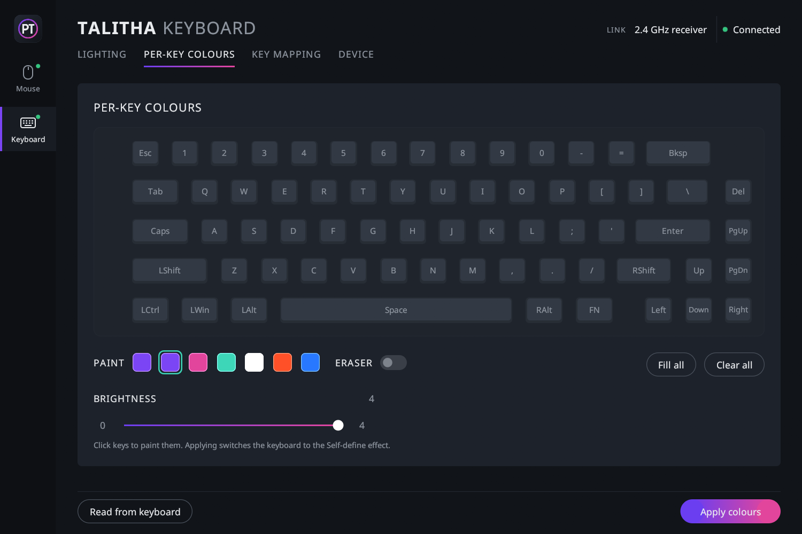
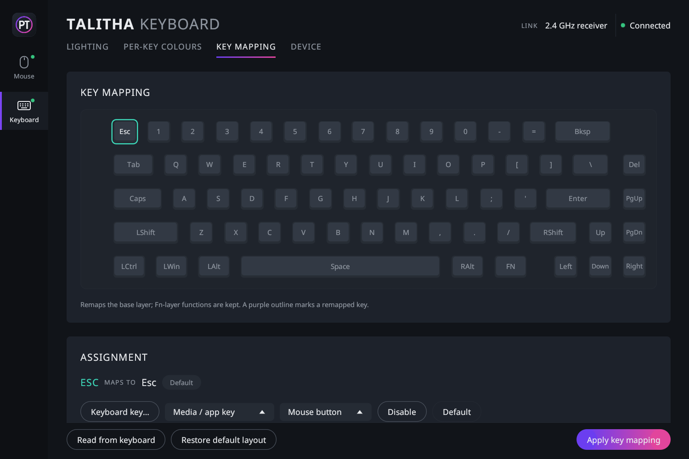

# PolariTha

A Linux port of the vendor configuration software for the **AQIRYS Polaris Wired** mouse
and the **AQIRYS Talitha** keyboard (over a USB cable, its 2.4 GHz receiver or Bluetooth), written in Rust.
It's a single binary with an egui GUI and a small CLI, and it talks to the devices
directly through `/dev/hidraw*`.

The [protocol notes](docs/PROTOCOL.md) document the HID reports used by both devices, and
[findings/](findings/README.md) explains how they were found, what was verified on hardware, and
what is still unknown.
To add another AQIRYS product, follow the [Linux reverse-engineering guide](docs/REVERSE_ENGINEERING.md),
or point an AI coding agent at [prompt.md](prompt.md), and submit your working implementation to
PolariTha as a pull request.

| | |
|---|---|
|  |  |
|  |  |
|  |  |

Screenshots are generated by the app itself: `POLARITHA_SCREENSHOTS=docs/screenshots polaritha`
walks every page, saves a PNG of each, and quits.

## Install

```sh
./install.sh          # cargo build --release, installs to ~/.local/bin,
                      # adds a menu entry and the udev rule (asks for sudo)
```

Without the udev rule (`packaging/70-polaritha.rules`, installed to
`/etc/udev/rules.d/`) only root can open the devices.

## Features

**Polaris Wired (mouse)** has 5 on-board profiles:
- polling rate 125/250/500/1000 Hz
- 1–8 DPI stages, 50–19000 DPI, with a colour per stage and a selectable current stage
- X/Y sensitivity, lift-off distance (low/high), key response
- 12 lighting effects with brightness and speed, plus a fixed colour, an 8-colour cycle, or the Slide colour
- remapping for the 9 buttons: mouse functions, DPI/profile/polling-rate switching,
  media/app keys, office shortcuts, any keyboard key combination, or disabled

The vendor tool never reads settings back from the mouse, so this app doesn't either.
Settings are stored in `~/.config/polaritha/polaris.json`, and **Apply** writes all
profiles to the mouse.

**Talitha (keyboard, over a USB cable, the 3554:fa09 receiver or Bluetooth):**
- reads the current lighting state from the keyboard
- 18 effects (the vendor hides a 19th, "Retinue scanning", for this model) with
  brightness 0–4 and speed 1–4
- colour: a 7-slot palette per effect that you can edit, or rainbow ("colour mixing")
- sleep timer (10/20/40/60 min, never)
- per-key RGB painting ("Self-define" effect)
- base-layer key remapping to keys/combos, media keys, mouse buttons, or disabled
- factory reset

Keyboard state is stored in `~/.config/polaritha/talitha.json`.

## CLI

```
polaritha                 # GUI
polaritha list            # show hidraw devices, marks the config interfaces
polaritha mouse-apply     # write saved mouse settings
polaritha mouse-profile 2
polaritha kb-status
polaritha kb-effects
polaritha kb-effect 1 --brightness 4 --color ff8800
polaritha kb-effect 3 --speed 2
polaritha -v …            # dump raw HID traffic
```

## Not ported

- mouse macros, the "gun" (recoil) feature, and Office/Game button modes
- keyboard macros, Fn-layer editing, music/screen-sync lighting, firmware update

## Connections

The keyboard works over all three of its connections, using the first one that
is available:

1. **USB cable** (258a:0236, shown as "BY Tech USB Keyboard"): 520-byte feature
   reports. Reads and writes take a few milliseconds.
2. **Bluetooth** ("Talitha BT3.0", 3554:fa08).
3. **2.4 GHz receiver** (3554:fa09).

## Bluetooth

When the keyboard is connected over Bluetooth ("Talitha BT3.0", 3554:fa08; BLE
would be 3554:fa07), the app talks to it directly over BT. It uses the same protocol as the receiver, except that
liveness is checked with GetPSD instead of the receiver's link query.

The read path is lossy on some laptops: the keyboard sends its 10-packet config
reply in bursts and many packets never reach the host (on the Realtek combo
card it was tested with, most of each burst was lost). The app keeps re-requesting and merges
packets by index, which takes 5–20 s. If a few packets still haven't arrived
at the deadline, those gaps are filled from the last complete config read from
the keyboard (`~/.config/polaritha/talitha_config_cache.json`). Writes are
acknowledged per packet and stay reliable; a 128-byte config write takes a few
seconds.

## Notes

- The keyboard has to be awake and connected. Over the receiver or Bluetooth, if it is
  reported as offline, press a key and click **Read from keyboard**.
- Per-key colours assume the LED index equals the key's matrix index (the vendor
  KB.ini only gives one index per key).
